# btab


[BTAB (Blue Team Analyisis Box)](https://github.com/Martin2877/btab) 是一个蓝队分析工具箱，专注于攻击特征分析与告警研判。可辅助安全运营人员完成流量包分析、HTTP 报文研判、Web 访问日志分析、攻击载荷识别、加密流量解密等场景。单文件二进制开箱即用，提供 Web 界面与命令行两种使用方式，并可通过内置的 `btab.lua` 插件在 Wireshark 中直接调用。

感谢AI, 历时3年后，终于能够将大部分思路进行落地实现！🎉之前纯手工开发，很多思路都开发得很艰难，现在通过AI的开发能够实现落地了！目前集成了流量包分析、payload分析、日志分析等，还有nuclei集成、js引擎的实现，提供了一个思路，供大家参考。

<a href="./README.md">English</a> -
<a>简体中文</a>

## 目录

- [btab](#btab)
  - [目录](#目录)
  - [文档跳转](#文档跳转)
  - [功能](#功能)
  - [功能界面截图](#功能界面截图)
  - [开始使用](#开始使用)
    - [命令行使用](#命令行使用)
  - [开发编译说明](#开发编译说明)
    - [前端开发](#前端开发)
    - [后端开发](#后端开发)
  - [插件化模块开发说明](#插件化模块开发说明)
    - [插件结构接口](#插件结构接口)
  - [技术栈](#技术栈)
  - [Q\&A](#qa)
  - [交流](#交流)
  - [更新日志](#更新日志)
    - [v1.1.0](#v110)
    - [v0.5.x](#v05x)
    - [v0.3.x](#v03x)
  - [趋势](#趋势)

## 文档跳转

- 关键内容

[开发编译说明](#开发编译说明)

[插件化模块开发说明](#插件化模块开发说明)

[调查分析模块与 jupyter说明](./investigation/doc/README_zh-cn.md)

[Wireshark 插件（btab.lua）使用说明](./wireshark/README.md)

- 议题分享文档

[btab蓝队分析工具箱-ali0th-v1.0.pdf](btab蓝队分析工具箱-ali0th-v1.0.pdf)


## 功能

- **一键分析**：粘贴载荷文本、上传 pcap 或 Web 访问日志，自动编排适用的检测方式并产出结构化分析报告（攻击链路、检出明细）。
- **威胁仓库**：pcap / payload / webshell / 访问日志 / nuclei 模板统一入库 SQLite，sha1 去重，随包内置示例样本与官方 nuclei-templates。
- **风险检测**：流量包多策略并行检测、HTTP 报文深度解析（支持合成 pcap 导出）、攻击载荷智能识别（SQLi / XSS / Webshell / Bash / Log4j2 等）。
- **检测引擎**：nuclei 漏洞规则引擎、JS 行为检测引擎（内置 21 种策略，支持自定义脚本）、正则 URL 规则引擎，均可在线管理与调试。
- **辅助工具**：冰蝎 / 哥斯拉流量解密、Shiro rememberMe 密钥检测、Java 反序列化解析、Log4j2 lookup 解析、内嵌 CyberChef 等。
- **扩展集成**：jupyter + gRPC 调查分析扩展（[文档](./investigation/doc/README_zh-cn.md)）；Wireshark `btab.lua` 插件，右键即可调用检测能力（[文档](./wireshark/README.md)）。

## 功能界面截图

- 一键分析（统一入口 / 分析报告 / 任务列表）

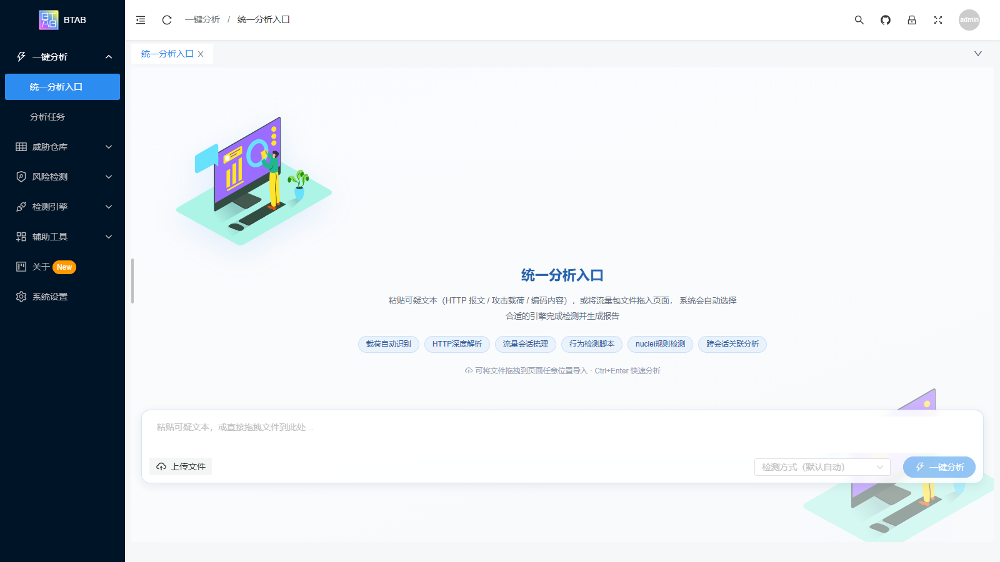

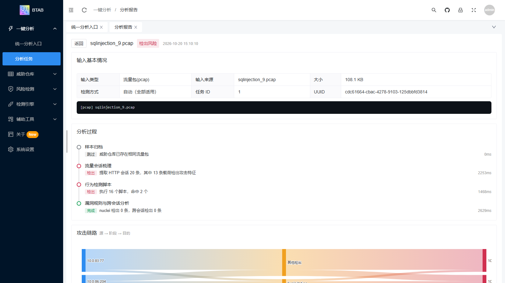

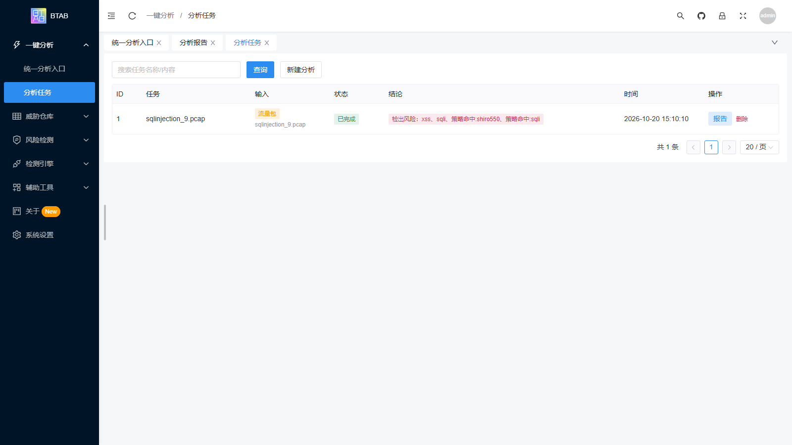

- 风险检测（流量包检测 / HTTP 深度解析 / 攻击载荷检测）

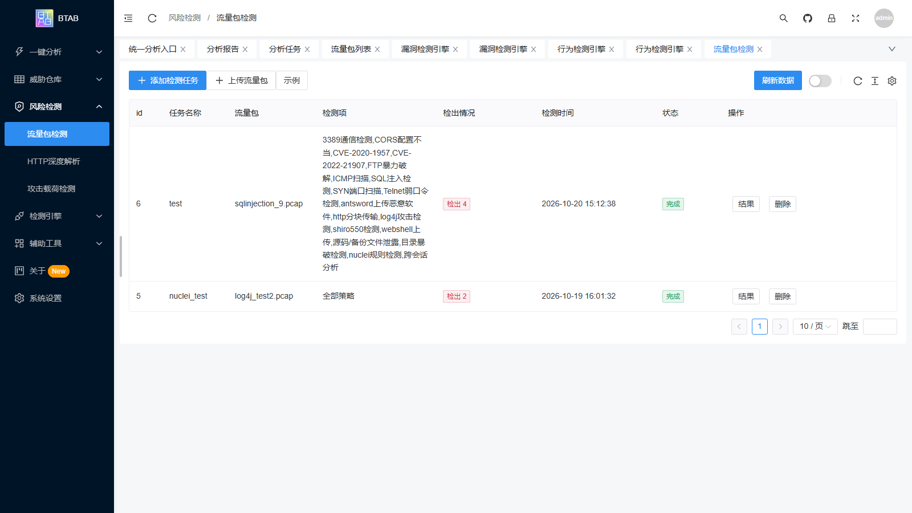

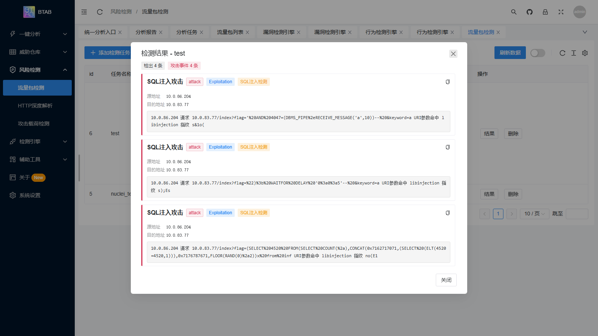

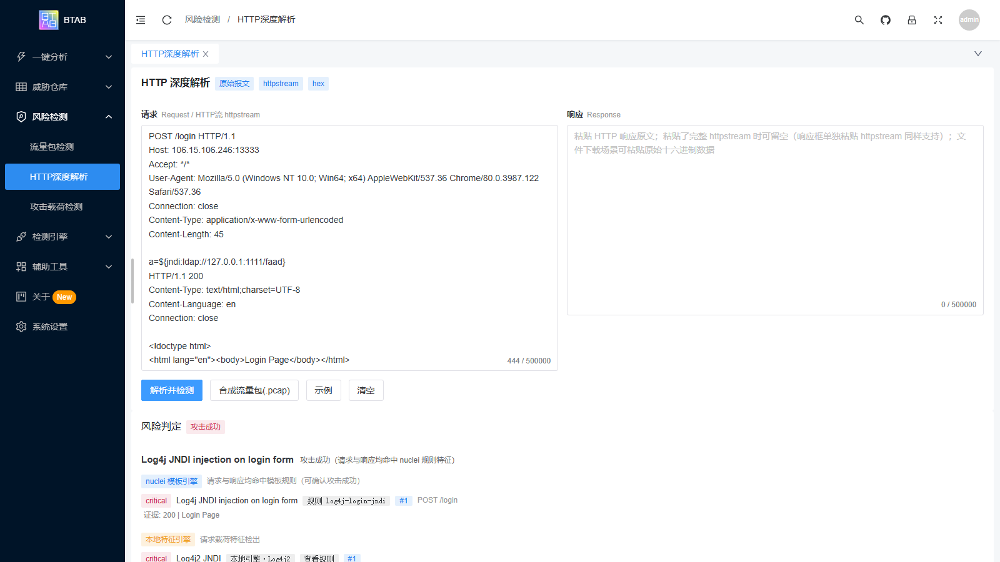

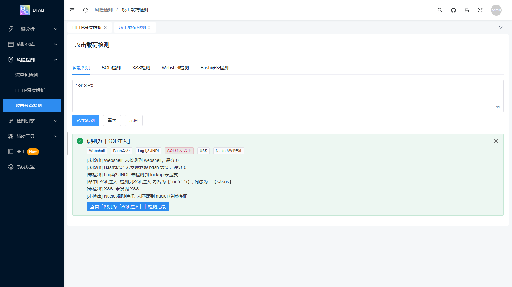

- 检测引擎（漏洞检测引擎 / 行为检测引擎）

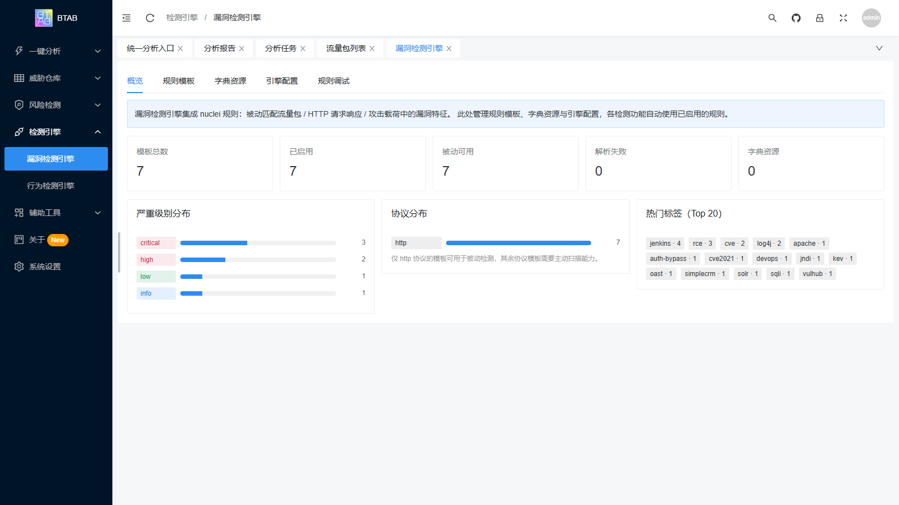

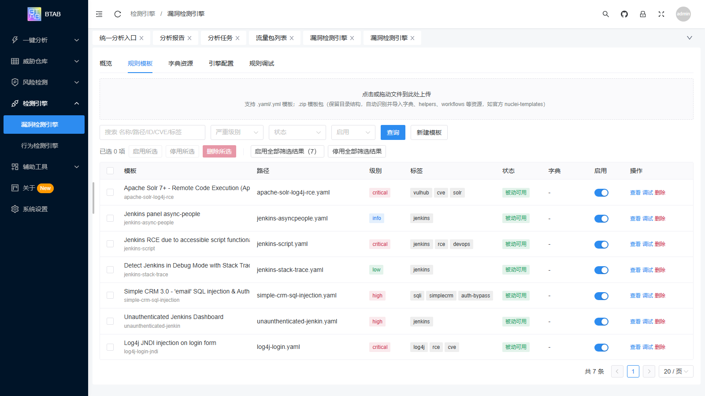

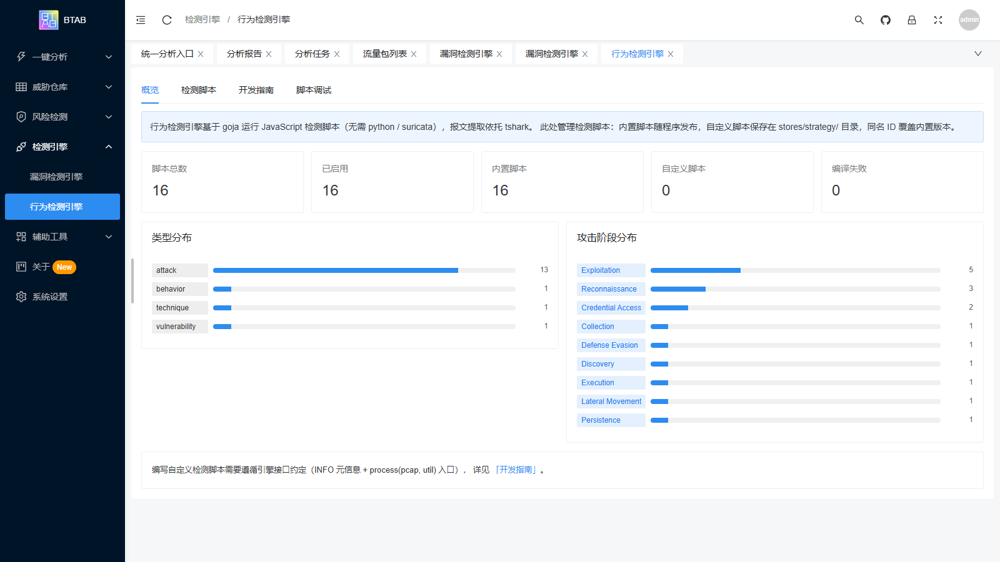

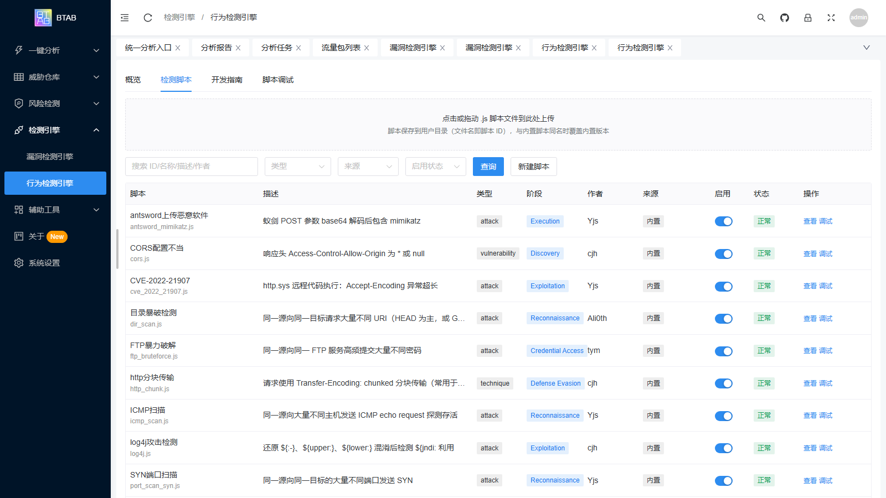

- 威胁仓库与辅助工具

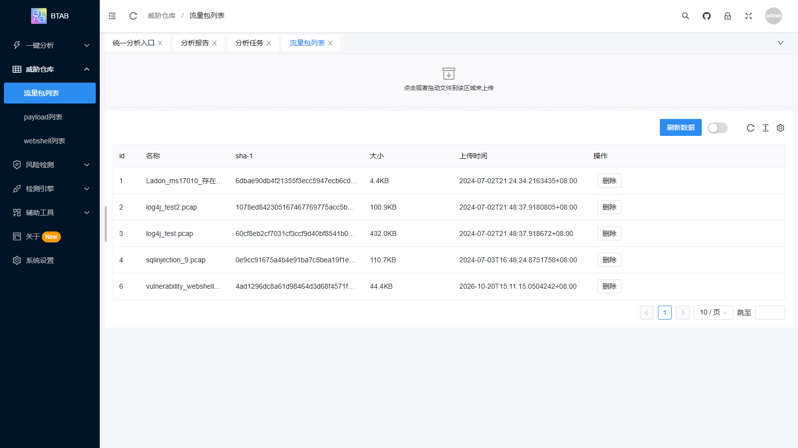

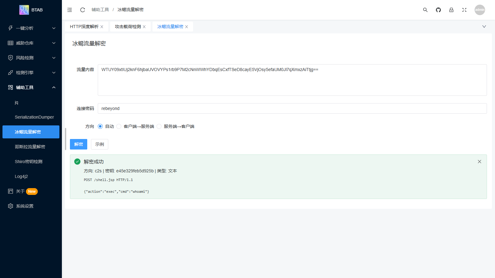

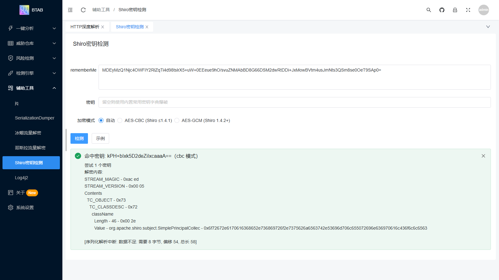

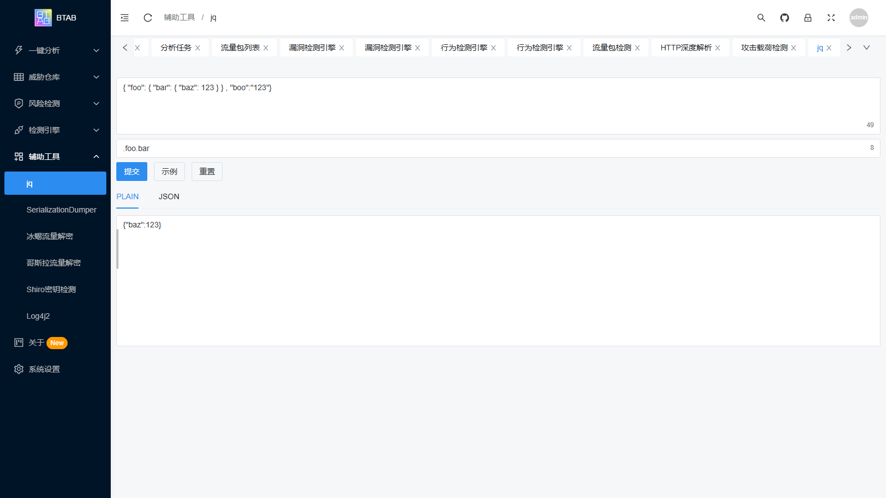

- jupyter 分析

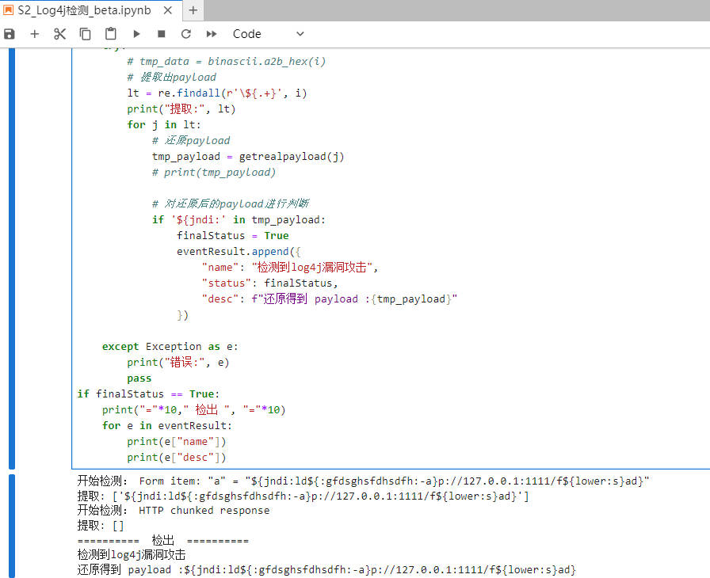

## 开始使用

- 下载

[前往releases下载](https://github.com/Martin2877/btab/releases)

- 配置

1. 流量包分析功能依赖 tshark，可在 `config.yaml` 中指定路径（通常启动时会自动探测常见安装路径，也可在 Web 界面"系统设置"中在线修改）：

```
pcapAnalyseConfig:
    # tsharkPath: tshark  # unix 环境
    tsharkPath: C:\Program Files\Wireshark\tshark.exe # win 环境
```

2. (可选) 使用 jupyter notebook 的相关依赖

```bash
pip install jupyterlab
pip install grpcio-tools
```

3. (可选) Wireshark 集成：将 `wireshark/btab.lua` 复制到 Wireshark 个人插件目录，即可在 Wireshark 中直接分析流量（需 Wireshark >= 4.2）。详见 [wireshark/README.md](./wireshark/README.md)。

- 执行

双击执行即可。启动后访问本地的 8001 端口： http://localhost:8001

### 命令行使用

```shell
# 启动为 web 服务（默认 8001 端口）
btab server
btab server -p 8001      # 指定端口
btab server --grpc       # 仅 grpc 模式

# 指定引擎进行分析
## 查看检测类引擎列表
btab engine -l
## 流量包解析
btab engine -e pcap -f file.pcap

# 工作流
## 查看 workflow 模板列表
btab wf -l
## 流量包检测流程（提取 HTTP 会话并逐条进行 SQLi 检测）
btab wf -t pcapcheck -f xxx.pcap
btab wf -t pc -f xxx.pcap        # pc 为 pcapcheck 的别名
## SQL 注入检测
btab wf -t sqli -c "' and 1+1"
```

## 开发编译说明

### 前端开发

- 安装依赖

```bash
cd frontend

yarn install
```

- 运行

```bash
yarn dev
```

- 打包

```bash
yarn build
```

- 将前端嵌入到后端

前端通过 `go:embed` 内嵌进二进制，需要将 `./frontend/dist/` 目录拷贝到 `./backend/web/dist`，然后在 `./backend/` 下执行 `go build` 即可。

也可以直接使用一键打包脚本（自动完成前端构建、dist 同步与 go build）：

```bash
bash backend/pack.sh           # dev 模式：增量构建，输出 release/btab_dev/
bash backend/pack.sh release   # 完整构建，输出 release/btab_windows_amd64.zip
```

### 后端开发

- 安装模块

```bash
cd ./backend
go mod tidy
go mod vendor
```

- 打包

```bash
go build
```

## 插件化模块开发说明

通过标准的接口实现统一的插件化模块规范，方便后续添加新的插件模块，目前有 `jq`、`pcap`、`SerializationDumper` 等模块, 只要遇到有新的场景，均可以增加进来。

并且，这些插件都可以被引擎调用，作为调查分析过程中的分析工具使用，理论上，可以无限扩展能力。

代码详细见 [plugin](./backend/engine/plugin/)

### 插件结构接口

```go
type Plugin interface {
	Init()  // 初始化
	Set(key string, value interface{})  // 设置插件所需变量
	Check() error  // 检查设置变量值
	Exec() error // 执行此插件
	GetState() int // 获取插件任务进度
	GetFinalStatus() int // 获取最终结果
	GetResult() string // 获取输出结果
}
```

## 技术栈

| 模块 | 技术 | 备注 |
| ----- | ----- | ----- |
| 前端框架 | vue3 + vite |  |
| 前端UI框架 | naive ui |  |
| 后端语言 | golang |  |
| 后端 Web | gin |  |
| 数据存储 | gorm + sqlite | 威胁仓库、检测任务、模板脚本均入库 |
| 漏洞检测引擎 | nuclei v3 | 加载 YAML 模板识别 pcap / http 报文中的攻击 |
| 行为检测引擎 | goja | JavaScript 编写的检测脚本，可在线扩展 |
| URL 检测引擎 | go regexp | 内置 webloghunter 衍生规则集，在线管理 |
| 流量包解析 | tshark + gopacket | 需配置 tshark 路径 |
| Wireshark 集成 | Lua 插件 + REST API | `wireshark/btab.lua`，需 Wireshark >= 4.2 |
| 调查分析 | python | grpc / jupyter |

## Q&A

<details>
  <summary>本工具的开发背景是什么？</summary>
  <p> 笔者从事安全行业以来，一直专注于流量安全分析领域，同时也对软件研发感兴趣。
  本项目一方面是分享平时的研究成果，促进交流学习，另一方面是国内对于蓝队这方面的交流太少了，现在都是红队方面较多，希望可以通过这个方式组建一个在蓝队方面研究的交流群体
  </p>
</details>

## 交流

可以加入群聊或加我[Ali0th](https://github.com/Martin2877)好友进入群聊。


## 更新日志

### v1.1.0

大版本优化：整体 UI 重构，检测能力由"单点工具"升级为"引擎 + 策略 + 任务"体系。

- [x] 统一分析入口：粘贴载荷 / 上传 pcap / 上传 web 访问日志一键分析，自动归档样本并生成结构化分析报告（攻击链路、检出明细）
- [x] 加载 nuclei yaml 模板识别 pcap 中的攻击，模板可在线管理、调试、批量启停，支持 zip 模板包导入，随包内置官方 nuclei-templates
- [x] JS 行为检测脚本引擎（goja 运行时）：内置 21 种检测策略，覆盖 pcap 流量与 web 访问日志两类数据源，支持上传自定义脚本扩展，可在线调试
- [x] URL 规则检测引擎：正则匹配 URL / UA / Referer，内置 webloghunter 衍生规则集，支持在线编辑、校验、批量启停与 rules.yaml 导入
- [x] Web 访问日志分析：nginx/apache 日志上传入库，联动 URL 规则与日志行为策略检出目录爆破、注入喷洒、webshell 访问等行为
- [x] Wireshark Lua 插件（`btab.lua`）：数据包右键菜单与整包梳理、会话级 nuclei 检测、跨帧 webshell 解密、Expert Information / `btab.*` 告警标注
- [x] 流量包检测策略化：多策略并行执行、实时进度、检出详情展示
- [x] HTTP 深度解析：原始报文 / httpstream / hex 输入，自动拆分请求响应对并识别风险，支持合成 pcap 导出
- [x] 攻击载荷智能识别：自动分类并联动 SQLi / XSS / Webshell / Bash / Log4j2 / nuclei 特征各引擎
- [x] 冰蝎、哥斯拉流量解密，Shiro 密钥检测，Log4j2 解析与生成等辅助工具
- [x] 各类样本、模板、任务均存储到数据库（sqlite），而非文件
- [x] 命令行版本：`server` / `engine` / `workflow` 子命令
- [x] 系统设置在线化：配置在线查看与修改、tshark 自动探测

### v0.5.x

第一版本实现大体的框架，但为了实现无依赖导致整体打包困难、体积较大，且扩展能力不足等问题，第二部版本需要进行优化。通过 DSL 语法和 python jupyter 增加分析能力，通过 grpc 实现扩展能力。

- [x] 插件化模块
- [x] 通用联调引擎，实现多模块串联处理
- [x] DSL语法查询功能
- [x] jupyter分析流量包功能
- [x] grpc 实现

### v0.3.x

- [x] 基本框架实现

## 趋势

[](https://starchart.cc/Martin2877/btab)

